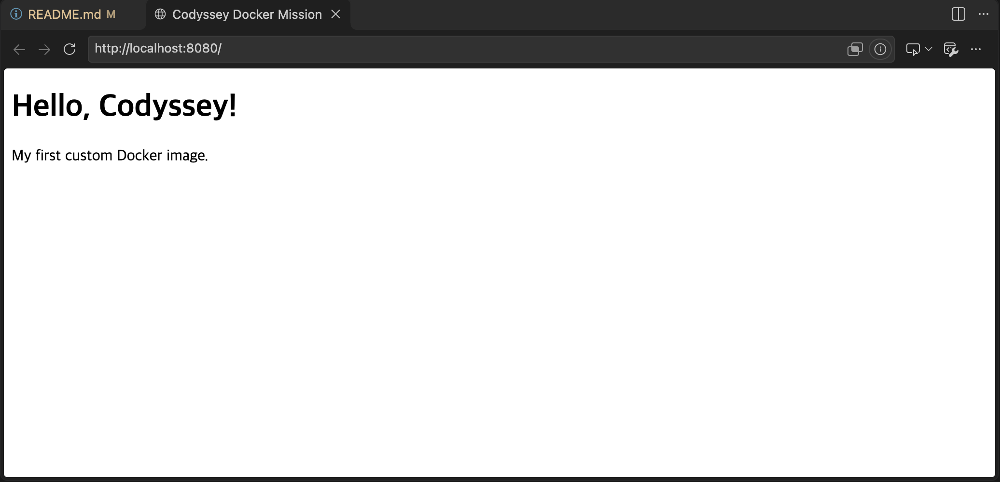
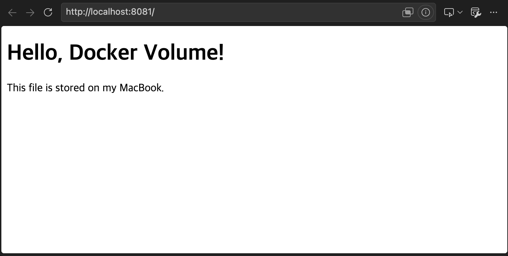
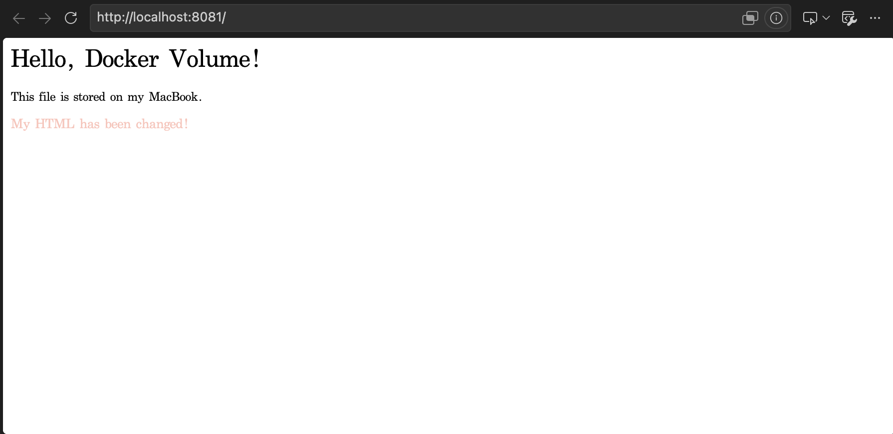

# codyssey1
# 코디세이 미션 수행 기술문서

## 1. 프로젝트 개요

### 미션 목표
본 프로젝트는 터미널 환경에서 기본적인 시스템 명령어와 권한을 이해하고, Docker를 활용한 컨테이너 환경을 구성하며, Git과 GitHub를 이용해 작업 내용을 관리하고 공유하는 것을 목표로 한다.

### 주요 수행 내용
- 터미널을 이용한 파일 및 디렉터리 관리
- 파일 권한 확인 및 변경
- Docker 이미지 및 컨테이너 관리
- Dockerfile 작성 및 이미지 빌드
- 포트 및 볼륨 설정과 검증
- Git을 이용한 버전 관리
- GitHub 저장소 생성 및 작업 결과 업로드

## 2. 실행 환경

| 항목 | 환경 |
|---|---|
| 운영체제(OS) | macOS [27.0] |
| 쉘(Shell) | /bin/zsh |
| 터미널 | macOS Terminal, VS Code 통합 터미널 |
| Docker | [29.9.2] |
| Git | git version 2.54.0 (Apple Git-157) |
| GitHub | https://github.com/1cando/codyssey1 |

### 환경 확인 명령어

```bash
sw_vers
echo $SHELL
docker --version
git --version
git remote -v
```

각 명령어의 실행 결과를 통해 운영체제, 쉘, Git 및 Docker 버전을 확인한다.

## 3. 수행 항목 체크리스트

### 3.1 터미널

| 확인 | 수행 항목 | 명령어 |
|---|---|---|
| [x] | 현재 위치 확인 | `pwd` |
| [x] | 파일 및 디렉터리 생성 | `mkdir`, `touch` |
| [x] | 파일과 폴더 목록 확인 | `ls`, `ls -al` |
| [x] | 디렉터리 이동 | `cd` |
| [x] | 파일 내용 확인 | `cat` |

#### ① 현재 위치 확인

**사용 명령어:** `pwd`

```bash
% pwd
/Users/[사용자계정]/codyssey
```

현재 터미널이 위치한 디렉터리의 경로를 확인한다.

#### ② 파일 및 디렉터리 생성

**사용 명령어:** `mkdir`, `touch`

```bash
% mkdir codyssey1
% cd codyssey1
% touch README.md
```

- `mkdir`: 새로운 디렉터리를 생성한다.
- `touch`: 새로운 빈 파일을 생성한다.

#### ③ 파일과 폴더 목록 확인

**사용 명령어:** `ls`, `ls -al`

```bash
% ls
codyssey1

% ls -al
drwxr-xr-x  13 [사용자계정]  staff   416 Oct 30 00:01 .git
-rw-r--r--@  1 [사용자계정]  staff    10 Oct 29 23:56 .gitignore
-rw-r--r--@  1 [사용자계정]  staff  5260 Oct 30 17:23 README.md
```

- `ls`: 현재 디렉터리의 파일과 폴더 목록을 확인한다.
- `ls -al`, `ls -la`: 숨김 파일을 포함하여 파일 권한, 소유자, 크기, 수정 날짜 등의 상세 정보를 확인한다.
- `-a`: 숨김 파일까지 표시한다.
- `-l`: 상세 정보를 표시한다.

#### ④ 디렉터리 이동

**사용 명령어:** `cd`

```bash
% cd codyssey
% cd codyssey1
% cd ..
% cd ~
```

- `cd codyssey`: codyssey 디렉터리로 이동한다.
- `cd ..`: 현재 디렉터리의 상위 디렉터리로 이동한다.
- `cd ~`: 사용자 홈 디렉터리로 이동한다.

#### ⑤ 파일 내용 확인

**사용 명령어:** `cat`

```bash
% cat README.md
# codyssey1
# 코디세이 미션 수행 기술문서

## 1. 프로젝트 개요

### 미션 목표
본 프로젝트는 ...
```

`cat` 명령어를 사용하여 README.md 파일에 작성된 내용을 터미널에서 확인한다.

#### ⑥ 절대 경로와 상대 경로

경로(Path)는 파일이나 디렉터리가 저장된 위치를 나타낸다.

**절대 경로(Absolute Path)**

- 루트 디렉터리(`/`)부터 시작하여 파일이나 폴더까지의 전체 경로를 나타낸다.
- 현재 터미널의 위치와 관계없이 동일한 경로를 사용할 수 있다.
- 예시: `/Users/[사용자계정]/codyssey/codyssey1/README.md`

**상대 경로(Relative Path)**

- 현재 작업 중인 디렉터리를 기준으로 파일이나 폴더의 위치를 나타낸다.
- 현재 위치에 따라 경로가 달라질 수 있다.
- 예시: `codyssey1/README.md`

**주요 경로 기호**

| 기호 | 의미 |
|---|---|
| `/` | 루트 디렉터리 |
| `~` | 사용자 홈 디렉터리 |
| `.` | 현재 디렉터리 |
| `..` | 상위 디렉터리 |

**실습 명령어**

```bash
# 상대 경로로 이동
cd ~/codyssey
cd codyssey1

# 상위 디렉터리로 이동
cd ..

# 절대 경로로 이동
cd ~/codyssey/codyssey1
cd /Users/[사용자계정]/codyssey/codyssey1
```

절대 경로는 전체 위치를 지정하는 방식이고, 상대 경로는 현재 위치를 기준으로 이동하는 방식이다.

---

### 3.2 파일 권한

파일 권한은 파일이나 디렉터리에 대해 사용자가 어떤 작업을 할 수 있는지 정하는 규칙이다.
리눅스와 macOS에서는 기본적으로 권한을 세 가지로 구분한다.

#### 3.2.1 파일 권한 표기 규칙 및 의미
리눅스의 파일 권한은 사용자가 파일이나 디렉터리에 대해 수행할 수 있는 작업을 제한하는 기능이다.

| 기호 | 숫자 | 영문 | 의미 | 설명 |
|---|---|---|---|---|
| r | 4 | Read | 읽기 | 파일 내용을 읽을 수 있음 |
| w | 2 | Write | 쓰기 | 파일 내용을 수정할 수 있음 |
| x | 1 | Execute | 실행 | 파일을 실행할 수 있음 |
| - | 0 | None | 권한 없음 | 해당 작업을 할 수 없음 |

각 숫자를 더하여 권한을 표현한다.

7 = 4 + 2 + 1 = rwx
6 = 4 + 2 = rw-
5 = 4 + 1 = r-x
4 = 4 = r--

- 755 권한: 소유자는 읽기, 쓰기, 실행이 가능하고 그룹과 그 외 사용자는 읽기와 실행이 가능하다. (rwxr-xr-x)
- 644 권한: 소유자는 읽기와 쓰기가 가능하고 그룹과 그 외 사용자는 읽기만 가능하다. (rw-r--r--)


#### 3.2.2 파일 권한 그룹
파일 권한은 세 그룹으로 구분한다.

| 기호 | 영문 | 대상 | 설명 |
|---|---|---|---|
| u | User | 파일 소유자 | 모든 권한 가능 | 
| g | Group | 파일이 속한 그룹 | 읽기와 실행 가능 |
| o | Others | 그 외 모든 사용자 | 읽기만 가능 |

#### 3.2.3 맨 앞 문자 종류
| 기호 | 종류 | 의미 |
|---|---|---|
| - | 일반 파일 | 텍스트, 이미지, 문서 등 |
| d | 디렉터리 | 폴더 |
| l | 심볼릭 링크 | 다른 파일이나 폴더를 가리키는 연결 |
| c | 문자 장치 파일 | 키보드, 터미널 등 문자 단위 장치 |
| b | 블록 장치 파일 | 디스크 등 블록 단위 장치 |
| p | 파이프 | 프로세스 간 데이터 전달 |
| s | 소켓 | 프로세스 간 통신 |

#### 3.2.4 파일 권한 명령어

| 확인 | 수행 항목 | 명령어 |
|---|---|---|
| [x] | 파일 권한 확인 | `ls -l` |
| [x] | 권한 변경 | `chmod` |

##### ① 파일 권한 확인

**사용 명령어:** `ls -l`

```bash
% ls -l permission-test.txt 
-rw-r--r--@ 1 [사용자계정]  staff  0 Oct 30 18:09 permission-test.txt
```

파일의 권한을 확인한다.

##### ② 권한 변경

**사용 명령어:** `chmod`

```bash
% chmod 600 permission-test.txt 
% ls -l
-rw-------@ 1 [사용자계정]  staff     0 Oct 30 18:09 permission-test.txt

% chmod 644 permission-test.txt
% ls -l
-rw-r--r--@ 1 [사용자계정]  staff     0 Oct 30 18:09 permission-test.txt

% chmod 755 permission-test.txt
% ls -l
-rwxr-xr-x@ 1 [사용자계정]  staff     0 Oct 30 18:09 permission-test.txt
```

파일의 권한을 변경한다.

---

### 3.3 Docker

Docker(도커)는 프로그램을 실행하는 데 필요한 환경을 하나로 묶어서 어디서든 비슷하게 실행할 수 있도록 도와주는 도구이다.
- [x] Docker 설치 및 실행 상태 확인
- [x] 이미지 조회 및 관리
- [x] 컨테이너 생성 및 실행
- [x] 컨테이너 상태 확인 및 종료

#### 3.3.1 Docker의 핵심 개념
| 개념 | 의미 | 비유 |
|---|---|---|
| Docker Image | 프로그램 실행에 필요한 컨테이너를 만들기 위한 템플릿 | 붕어빵 틀 |
| Docker Container | 이미지를 기반으로 실행한 인스턴스 | 실제 붕어빵 |
| Dockerfile | 이미지를 만드는 방법을 작성한 설계도 | 붕어빵 제작 설명서 |

Dockerfile로 Nginx와 웹페이지를 포함하는 방법을 작성하고, Docker 이미지로 만든 후 그 이미지를 실행하면 컨테이너가 생성된다.
브라우저에서 웹페이지를 볼 수 있다.

#### 3.3.2 Docker 설치 및 실행 상태 확인

Docker Desktop을 설치하고 실행한 후 터미널에서 Docker 명령어가 정상적으로 작동하는지 확인한다.

**사용 명령어** `docker --version`, `docker info`

```bash
# Docker 버전 확인
% docker --version
Docker version 29.9.2, build a82e528

# Docker 실행 환경 및 상태 확인
% docker info
Client:
 Version:    29.9.2
 Context:    desktop-linux
 Debug Mode: false
 Plugins:
  agent: Docker AI Agent Runner (Docker Inc.)
    Version:  v1.152.0
    Path:     /Users/[사용자계정]/.docker/cli-plugins/docker-agent
```

#### 3.3.3 이미지 조회 및 관리

Docker 이미지는 컨테이너를 생성하기 위한 읽기 전용 템플릿이다. 이미지 목록을 조회하여 현재 보유한 이미지를 확인한다.

**사용 명령어** `docker images`

```bash
# 로컬 이미지 목록 확인
% docker images
IMAGE             ID             DISK USAGE   CONTENT SIZE   EXTRA
codyssey-web:v1   d20d2b57f685       93.2MB         26.3MB 
```

#### 3.3.4 컨테이너 생성 및 실행

컨테이너는 Docker 이미지를 기반으로 실행되는 독립적인 환경이다.

**사용 명령어** `docker ps -a`

```bash
# 전체 컨테이너 목록 확인
% docker ps -a
CONTAINER ID   IMAGE     COMMAND   CREATED   STATUS    PORTS     NAMES
```

#### 3.3.5 컨테이너 상태 확인 및 종료

컨테이너의 실행 상태와 로그를 확인하고, 실행 중인 컨테이너를 종료한다.

**사용 명령어**

```bash
# 실행 중인 컨테이너 확인
docker ps

# 전체 컨테이너 확인
docker ps -a

# 컨테이너 로그 확인
docker logs codyssey-container

# 컨테이너 리소스 사용량 확인
docker stats --no-stream codyssey-container

# 컨테이너 중지
docker stop codyssey-container

# 컨테이너 실행
docker start codyssey-container
```

**실행 결과**

```bash
% docker ps
CONTAINER ID   IMAGE             COMMAND                  CREATED         STATUS         PORTS                                     NAMES
5a42650d04b4   codyssey-web:v1   "/docker-entrypoint.…"   3 minutes ago   Up 3 minutes   0.0.0.0:8080->80/tcp, [::]:8080->80/tcp   codyssey-container

% docker ps -a
CONTAINER ID   IMAGE             COMMAND                  CREATED         STATUS         PORTS                                     NAMES
5a42650d04b4   codyssey-web:v1   "/docker-entrypoint.…"   7 minutes ago   Up 7 minutes   0.0.0.0:8080->80/tcp, [::]:8080->80/tcp   codyssey-container

% docker logs codyssey-container
/docker-entrypoint.sh: /docker-entrypoint.d/ is not empty, will attempt to perform configuration
/docker-entrypoint.sh: Looking for shell scripts in /docker-entrypoint.d/
/docker-entrypoint.sh: Launching /docker-entrypoint.d/10-listen-on-ipv6-by-default.sh
10-listen-on-ipv6-by-default.sh: info: Getting the checksum of /etc/nginx/conf.d/default.conf
10-listen-on-ipv6-by-default.sh: info: Enabled listen on IPv6 in /etc/nginx/conf.d/default.conf
/docker-entrypoint.sh: Sourcing /docker-entrypoint.d/15-local-resolvers.envsh
/docker-entrypoint.sh: Launching /docker-entrypoint.d/20-envsubst-on-templates.sh
/docker-entrypoint.sh: Launching /docker-entrypoint.d/30-tune-worker-processes.sh
/docker-entrypoint.sh: Configuration complete; ready for start up
2026/10/30 11:51:56 [notice] 1#1: using the "epoll" event method
2026/10/30 11:51:56 [notice] 1#1: nginx/1.31.8
2026/10/30 11:51:56 [notice] 1#1: built by gcc 15.2.0 (Alpine 15.2.0) 
2026/10/30 11:51:56 [notice] 1#1: OS: Linux 7.0.14-linuxkit
2026/10/30 11:51:56 [notice] 1#1: getrlimit(RLIMIT_NOFILE): 1048576:1048576
2026/10/30 11:51:56 [notice] 1#1: start worker processes
2026/10/30 11:51:56 [notice] 1#1: start worker process 30
2026/10/30 11:51:56 [notice] 1#1: start worker process 31
2026/10/30 11:51:56 [notice] 1#1: start worker process 32
2026/10/30 11:51:56 [notice] 1#1: start worker process 33
2026/10/30 11:51:56 [notice] 1#1: start worker process 34
2026/10/30 11:51:56 [notice] 1#1: start worker process 35
2026/10/30 11:51:56 [notice] 1#1: start worker process 36
2026/10/30 11:51:56 [notice] 1#1: start worker process 37
2026/10/30 11:51:56 [notice] 1#1: start worker process 38
2026/10/30 11:51:56 [notice] 1#1: start worker process 39
2026/10/30 11:51:56 [notice] 1#1: start worker process 40
2026/10/30 11:51:56 [notice] 1#1: start worker process 41
2026/10/30 11:51:56 [notice] 1#1: start worker process 42
2026/10/30 11:51:56 [notice] 1#1: start worker process 43
2026/10/30 11:51:56 [notice] 1#1: start worker process 44
192.168.65.1 - - [30/Oct/2026:11:55:57 +0000] "GET / HTTP/1.1" 200 212 "-" "Mozilla/5.0 (Macintosh; Intel Mac OS X 10_15_7) AppleWebKit/537.36 (KHTML, like Gecko) Code/1.144.0 Chrome/150.0.7871.250 Electron/43.8.3 Safari/537.36" "-"
192.168.65.1 - - [30/Oct/2026:11:55:57 +0000] "GET /favicon.ico HTTP/1.1" 404 555 "-" "Mozilla/5.0 (Macintosh; Intel Mac OS X 10_15_7) AppleWebKit/537.36 (KHTML, like Gecko) Code/1.144.0 Chrome/150.0.7871.250 Electron/43.8.3 Safari/537.36" "-"
2026/10/30 11:55:57 [error] 31#31: *1 open() "/usr/share/nginx/html/favicon.ico" failed (2: No such file or directory), client: 192.168.65.1, server: localhost, request: "GET /favicon.ico HTTP/1.1", host: "localhost:8080"

% docker stats --no-stream codyssey-container
CONTAINER ID   NAME                 CPU %     MEM USAGE / LIMIT     MEM %     NET I/O           BLOCK I/O         PIDS
5a42650d04b4   codyssey-container   0.00%     23.27MiB / 7.748GiB   0.29%     3.34kB / 1.86kB   10.5MB / 12.3kB   16

% docker stop codyssey-container
codyssey-container

% docker start codyssey-container
codyssey-container
```

---

### 3.4 Dockerfile

- [x] Dockerfile 작성
- [x] 이미지 빌드
- [x] 빌드 결과 확인
- [x] 기존 이미지를 기반으로 커스텀 이미지 생성

#### 3.4.1 Dockerfile 작성

Dockerfile은 Docker 이미지를 생성하기 위한 명령어를 작성한 파일이다.

기존 Nginx 이미지를 기반으로 사용하고, 직접 작성한 HTML 파일을 추가하여 커스텀 이미지를 제작한다.

**프로젝트 디렉터리 구조**

```text
codyssey1/
├── README.md
└── docker/
    ├── Dockerfile
    └── app/
        └── index.html
```

**1) 웹페이지 파일 작성 (`docker/app/index.html`)**

```html
<!DOCTYPE html>
<html lang="ko">
<head>
    <meta charset="UTF-8">
    <title>Codyssey Docker Mission</title>
</head>
<body>
    <h1>Hello, Codyssey!</h1>
    <p>My first custom Docker image.</p>
</body>
</html>
```

**웹페이지 파일 생성 명령어**
```bash
cat > docker/app/index.html <<'EOF'
<!DOCTYPE html>
<html lang="ko">
<head>
    <meta charset="UTF-8">
    <title>Codyssey Docker Mission</title>
</head>
<body>
    <h1>Hello, Codyssey!</h1>
    <p>My first custom Docker image.</p>
</body>
</html>
EOF
```
| 부분 | 의미 |
|---|---|
| cat | 텍스트 내용을 출력하거나 파일로 전달하는 명령어 |
| > | 왼쪽의 내용을 오른쪽 파일에 저장 |
| docker/app/index.html | 내용을 저장할 파일 경로 |
| << | 여러 줄의 입력을 시작하는 Here Document 문법 |
| 'EOF' | 입력이 끝나는 지점을 지정하는 표시 |

**2) Dockerfile 작성 (`docker/Dockerfile`)**

```bash
cat > docker/Dockerfile <<'EOF'
# 기존 Nginx 이미지 사용
FROM nginx:alpine

# 내 웹페이지를 Nginx 기본 웹 폴더에 복사
COPY app/ /usr/share/nginx/html/

# 웹 서버 포트
EXPOSE 80
EOF
```

**Dockerfile 주요 명령어 설명**

| 명령어 | 설명 |
|---|---|
| `FROM` | 기존 Docker 이미지를 기반 이미지로 지정 |
| `COPY` | 호스트의 파일이나 디렉터리를 이미지 내부로 복사 |
| `EXPOSE` | 컨테이너에서 사용할 포트를 문서화 |

| Dockerfile 명령어	| 역할 |
|---|---|
| FROM nginx:alpine	| Nginx가 들어 있는 기존 이미지를 기반으로 사용 |
| COPY app/ /usr/share/nginx/html/ | 내가 만든 웹페이지 파일을 이미지 내부에 복사 |
| EXPOSE 80 | 컨테이너가 사용할 웹 서버 포트를 표시 |

COPY는 docker/app/index.html을 Docker 이미지 안의 /usr/share/nginx/html/ 폴더로 복사한다.

**docker 파일 확인**

```bash
% ls -R docker
Dockerfile      app

docker/app:
index.html

% cat docker/Dockerfile
# 기존 Nginx 이미지 사용
FROM nginx:alpine

# 내 웹페이지를 Nginx 기본 웹 폴더에 복사
COPY app/ /usr/share/nginx/html/

# 웹 서버 포트
EXPOSE 80
```

#### 3.4.2 커스텀 이미지 빌드

작성한 Dockerfile을 기반으로 새로운 Docker 이미지를 생성한다.

**사용 명령어**

```bash
% docker build -t codyssey-web:v1 ./docker
```

- `docker build`: Docker 이미지 빌드
- `-t`: 이미지 이름과 태그 지정
- `codyssey-web`: 생성할 이미지 이름
- `v1`: 이미지 버전
- `./docker`: Dockerfile이 위치한 디렉터리

**실행 결과**
```text
[+] Building 6.7s (7/7) FINISHED                                                                                          docker:desktop-linux
 => [internal] load build definition from Dockerfile                                                                                      0.0s
 => => transferring dockerfile: 210B                                                                                                      0.0s
 => [internal] load metadata for docker.io/library/nginx:alpine                                                                           2.2s
 => [internal] load .dockerignore                                                                                                         0.0s
 => => transferring context: 2B                                                                                                           0.0s
 => [internal] load build context                                                                                                         0.0s
 => => transferring context: 282B                                                                                                         0.0s
 => [1/2] FROM docker.io/library/nginx:alpine@sha256:785835ea65db4bba6f021acc0f3be91b0fef76a53fe41f8588c6698d2aed0606                     4.1s
 => => resolve docker.io/library/nginx:alpine@sha256:785835ea65db4bba6f021acc0f3be91b0fef76a53fe41f8588c6698d2aed0606                     0.0s
 => => sha256:cbe54b031f3e1a4ce4471c96573084c6454f1c5f91e03bbd51c5bb5d90af7864 20.11MB / 20.11MB                                          2.6s
 => => sha256:c2fefbef531492feca04133b10436cc9783fce87888d03b115887db02b4f0610 1.40kB / 1.40kB                                            0.6s
 => => sha256:567a969e02211a0b0f51a1ac9b901e1bf88b7c79dbb994979df79b328fb64ab6 1.21kB / 1.21kB                                            0.6s
 => => sha256:dbb1ef19121a83d4810308cc89451dd32a5fafdf8d17da3f7c3a88a3edd70573 404B / 404B                                                0.7s
 => => sha256:f523b340a6c003e3b253f885115ab55af1d1f6a12a3fed8203adbe67173d805f 964B / 964B                                                0.3s
 => => sha256:7b9d02243238d0f039c78eac1c532b5cc281e680fedbb27aec087a6e8c85e0a1 629B / 629B                                                0.4s
 => => sha256:1408044c7403b2c319cdbb2cb2d18025d7997a703c1c1115dec6ae21fff824d3 1.96MB / 1.96MB                                            2.6s
 => => sha256:d3531b7a4f217bdc3426c57bcff84c170f086f456a39689d4a615c6d026c4be0 4.19MB / 4.19MB                                            2.8s
 => => extracting sha256:d3531b7a4f217bdc3426c57bcff84c170f086f456a39689d4a615c6d026c4be0                                                 0.1s
 => => extracting sha256:1408044c7403b2c319cdbb2cb2d18025d7997a703c1c1115dec6ae21fff824d3                                                 0.0s
 => => extracting sha256:7b9d02243238d0f039c78eac1c532b5cc281e680fedbb27aec087a6e8c85e0a1                                                 0.0s
 => => extracting sha256:f523b340a6c003e3b253f885115ab55af1d1f6a12a3fed8203adbe67173d805f                                                 0.0s
 => => extracting sha256:dbb1ef19121a83d4810308cc89451dd32a5fafdf8d17da3f7c3a88a3edd70573                                                 0.0s
 => => extracting sha256:567a969e02211a0b0f51a1ac9b901e1bf88b7c79dbb994979df79b328fb64ab6                                                 0.0s
 => => extracting sha256:c2fefbef531492feca04133b10436cc9783fce87888d03b115887db02b4f0610                                                 0.0s
 => => extracting sha256:cbe54b031f3e1a4ce4471c96573084c6454f1c5f91e03bbd51c5bb5d90af7864                                                 0.2s
 => [2/2] COPY app/ /usr/share/nginx/html/                                                                                                0.1s
 => exporting to image                                                                                                                    0.3s
 => => exporting layers                                                                                                                   0.0s
 => => exporting manifest sha256:0a5059bae661b8754109149c91e0763938c41616544acc234a7a1e8bb7445ab7                                         0.0s
 => => exporting config sha256:30200dec2dadccb65b72ae278077e1f4316b1401a00c94b7b1b62731e6248572                                           0.0s
 => => exporting attestation manifest sha256:9972f12b0cdc10ad6796570b90c6ebb6f36af95ae707701d265a51b4dcbdf2cb                             0.0s
 => => exporting manifest list sha256:d20d2b57f685e2df5aa78c65048ea0c42f864659780b85a60b3cb11f6773a664                                    0.0s
 => => naming to docker.io/library/codyssey-web:v1                                                                                        0.0s
 => => unpacking to docker.io/library/codyssey-web:v1 
```

#### 3.4.3 빌드 결과 확인

이미지가 정상적으로 생성되었는지 확인한다.

```bash
# 로컬 이미지 목록 확인
% docker images
IMAGE             ID             DISK USAGE   CONTENT SIZE   EXTRA
codyssey-web:v1   d20d2b57f685       93.2MB         26.3MB 
```

#### 3.4.4 커스텀 이미지 기반 컨테이너 실행

생성한 커스텀 이미지를 이용하여 컨테이너를 실행한다.

**사용 명령어**

```bash
docker run -d --name codyssey-container -p 8080:80 codyssey-web:v1
```

- `-d`: 백그라운드 모드로 실행
- `--name`: 컨테이너 이름 지정
- `-p 8080:80`: 호스트의 8080 포트와 컨테이너의 80 포트 연결
- `codyssey-web:v1`: 실행할 이미지 지정

**컨테이너 실행 확인**

```bash
% docker ps
CONTAINER ID   IMAGE             COMMAND                  CREATED         STATUS         PORTS                                     NAMES
5a42650d04b4   codyssey-web:v1   "/docker-entrypoint.…"   3 minutes ago   Up 3 minutes   0.0.0.0:8080->80/tcp, [::]:8080->80/tcp   codyssey-container
```

**웹페이지 접속 확인**

브라우저에서 다음 주소로 접속한다.

```text
http://localhost:8080
```

웹페이지에 `Hello, Codyssey!`가 표시되면 정상적으로 실행된 것이다.

**실행 결과**




#### 3.4.5 커스텀 이미지 제작 결과

기존 `nginx:alpine` 이미지를 기반으로 Dockerfile을 작성하고, 직접 만든 HTML 파일을 추가하여 `codyssey-web:v1` 커스텀 이미지를 생성하였다.

해당 이미지를 이용해 컨테이너를 실행하고, 호스트 포트 8080을 통해 웹페이지에 정상적으로 접근할 수 있음을 확인하였다.


### 3.5 포트 및 볼륨
- [x] 컨테이너 포트 매핑 설정
- [x] 포트 매핑 결과 확인
- [x] 볼륨 또는 디렉터리 마운트 설정
- [x] 데이터 유지 여부 확인

#### 1. 포트 매핑 (Port Mapping)

**포트 매핑이란?**

컨테이너 내부에서 실행되는 서비스에 호스트 컴퓨터가 접근할 수 있도록 포트를 연결하는 기능이다.
컨테이너는 독립된 네트워크 환경에서 실행되므로 외부에서 접근하려면 포트 매핑 설정이 필요하다.

**사용 명령어**

```bash
docker run -d --name codyssey-container -p 8080:80 codyssey-web:v1
```
여기서 -p 8080:80이 포트 매핑이다.
- 8080: 내 컴퓨터에서 사용하는 포트
- 80: 컨테이너 내부의 Nginx가 사용하는 포트

컨테이너는 독립된 환경에서 실행되기 때문에 컨테이너 내부의 포트가 내 컴퓨터에 자동으로 공개되는 것이 아니므로 포트 매핑을 해줘야 내 컴퓨터의 브라우저에서 컨테이너 안의 웹 서버에 접속할 수 있다.

| 옵션 | 설명 |
|---|---|
| `-d` | 컨테이너를 백그라운드에서 실행 |
| `--name` | 컨테이너 이름 지정 |
| `-p 8080:80` | 호스트의 8080번 포트와 컨테이너의 80번 포트 연결 |
| `codyssey-web` | 이미지 이름 |
| `v1` | 이미지 버전(Tag) |

**포트 매핑 결과 확인**

```bash
% docker port codyssey-container 
80/tcp -> 0.0.0.0:8080
80/tcp -> [::]:8080
```
컨테이너의 80번 포트가 호스트의 8080번 포트에 연결된 것을 확인할 수 있다.


**상세 설정 확인**

```bash
% docker inspect codyssey-container
[
    {
        "Id": "5a42650d04b430913e6042b47dcf9182a18239656656ffe24f68dc6a2b7eab3b",
        "Created": "2026-10-30T11:51:55.985151667Z",
        "Path": "/docker-entrypoint.sh",
        "Args": [
            "nginx",
            "-g",
            "daemon off;"
        ],
        "State": {
            "Status": "running",
            "Running": true,
            "Paused": false,
            "Restarting": false,
            "OOMKilled": false,
            "Dead": false,
            "Pid": 608,
            "ExitCode": 0,
            "Error": "",
            "StartedAt": "2026-11-01T14:43:24.634908676Z",
            "FinishedAt": "2026-10-30T12:05:33.86516567Z"
        },
        "Image": "sha256:d20d2b57f685e2df5aa78c65048ea0c42f864659780b85a60b3cb11f6773a664",
        "ResolvConfPath": "/var/lib/docker/containers/5a42650d04b430913e6042b47dcf9182a18239656656ffe24f68dc6a2b7eab3b/resolv.conf",
        "HostnamePath": "/var/lib/docker/containers/5a42650d04b430913e6042b47dcf9182a18239656656ffe24f68dc6a2b7eab3b/hostname",
        "HostsPath": "/var/lib/docker/containers/5a42650d04b430913e6042b47dcf9182a18239656656ffe24f68dc6a2b7eab3b/hosts",
        "LogPath": "",
        "Name": "/codyssey-container",
        "RestartCount": 0,
        "Driver": "overlayfs",
        "Platform": "linux",
        "MountLabel": "",
        "ProcessLabel": "",
        "AppArmorProfile": "",
        "ExecIDs": null,
        "HostConfig": {
            "Binds": null,
            "ContainerIDFile": "",
            "LogConfig": {
                "Type": "local",
                "Config": {}
            },
            "NetworkMode": "bridge",
            "PortBindings": {
                "80/tcp": [
                    {
                        "HostIp": "",
                        "HostPort": "8080"
                    }
                ]
            },
            "RestartPolicy": {
                "Name": "no",
                "MaximumRetryCount": 0
            },
            "AutoRemove": false,
            "VolumeDriver": "",
            "VolumesFrom": null,
            "ConsoleSize": [
                12,
                143
            ],
            "CapAdd": null,
            "CapDrop": null,
            "CgroupnsMode": "private",
            "Dns": [],
            "DnsOptions": [],
            "DnsSearch": [],
            "ExtraHosts": null,
            "GroupAdd": null,
            "IpcMode": "private",
            "Cgroup": "",
            "Links": null,
            "OomScoreAdj": 0,
            "PidMode": "",
            "Privileged": false,
            "PublishAllPorts": false,
            "ReadonlyRootfs": false,
            "SecurityOpt": null,
            "UTSMode": "",
            "UsernsMode": "",
            "ShmSize": 67108864,
            "Runtime": "runc",
            "Isolation": "",
            "CpuShares": 0,
            "Memory": 0,
            "NanoCpus": 0,
            "CgroupParent": "",
            "BlkioWeight": 0,
            "BlkioWeightDevice": [],
            "BlkioDeviceReadBps": [],
            "BlkioDeviceWriteBps": [],
            "BlkioDeviceReadIOps": [],
            "BlkioDeviceWriteIOps": [],
            "CpuPeriod": 0,
            "CpuQuota": 0,
            "CpuRealtimePeriod": 0,
            "CpuRealtimeRuntime": 0,
            "CpusetCpus": "",
            "CpusetMems": "",
            "Devices": [],
            "DeviceCgroupRules": null,
            "DeviceRequests": null,
            "MemoryReservation": 0,
            "MemorySwap": 0,
            "MemorySwappiness": null,
            "OomKillDisable": null,
            "PidsLimit": null,
            "Ulimits": null,
            "CpuCount": 0,
            "CpuPercent": 0,
            "IOMaximumIOps": 0,
            "IOMaximumBandwidth": 0,
            "MaskedPaths": [
                "/proc/acpi",
                "/proc/asound",
                "/proc/interrupts",
                "/proc/kcore",
                "/proc/keys",
                "/proc/latency_stats",
                "/proc/sched_debug",
                "/proc/scsi",
                "/proc/timer_list",
                "/proc/timer_stats",
                "/sys/devices/virtual/powercap",
                "/sys/firmware"
            ],
            "ReadonlyPaths": [
                "/proc/bus",
                "/proc/fs",
                "/proc/irq",
                "/proc/sys",
                "/proc/sysrq-trigger"
            ]
        },
        "Storage": {
            "RootFS": {
                "Snapshot": {
                    "Name": "overlayfs"
                }
            }
        },
        "Mounts": [],
        "Config": {
            "Hostname": "5a42650d04b4",
            "Domainname": "",
            "User": "",
            "AttachStdin": false,
            "AttachStdout": false,
            "AttachStderr": false,
            "ExposedPorts": {
                "80/tcp": {}
            },
            "Tty": false,
            "OpenStdin": false,
            "StdinOnce": false,
            "Env": [
                "PATH=/usr/local/sbin:/usr/local/bin:/usr/sbin:/usr/bin:/sbin:/bin",
                "NGINX_VERSION=1.31.8",
                "PKG_RELEASE=1",
                "DYNPKG_RELEASE=1",
                "NJS_VERSION=1.0.2",
                "NJS_RELEASE=1",
                "ACME_VERSION=0.4.1"
            ],
            "Cmd": [
                "nginx",
                "-g",
                "daemon off;"
            ],
            "Image": "codyssey-web:v1",
            "Volumes": null,
            "WorkingDir": "/",
            "Entrypoint": [
                "/docker-entrypoint.sh"
            ],
            "Labels": {
                "maintainer": "NGINX Docker Maintainers \u003cdocker-maint@nginx.com\u003e"
            },
            "StopSignal": "SIGQUIT"
        },
        "NetworkSettings": {
            "SandboxID": "3081a03f3297443f29c14ce66e786d470be901ef168b8ec8fc5dfd80ba27feff",
            "SandboxKey": "/var/run/docker/netns/3081a03f3297",
            "Ports": {
                "80/tcp": [
                    {
                        "HostIp": "0.0.0.0",
                        "HostPort": "8080"
                    },
                    {
                        "HostIp": "::",
                        "HostPort": "8080"
                    }
                ]
            },
            "Networks": {
                "bridge": {
                    "IPAMConfig": null,
                    "Links": null,
                    "Aliases": null,
                    "DriverOpts": null,
                    "GwPriority": 0,
                    "NetworkID": "19db3dae0772d040b4d1fe1c194e4d1243604f0b4e7399f92c7bff55cf0079be",
                    "EndpointID": "6adb3216a7949e9e7c8d4d0160c4b9d56ba598ba956eb473e1b78ab5c4e30456",
                    "Gateway": "172.17.0.1",
                    "IPAddress": "172.17.0.2",
                    "MacAddress": "4a:e5:76:66:dc:ba",
                    "IPPrefixLen": 16,
                    "IPv6Gateway": "",
                    "GlobalIPv6Address": "",
                    "GlobalIPv6PrefixLen": 0,
                    "DNSNames": null
                }
            }
        },
        "ImageManifestDescriptor": {
            "mediaType": "application/vnd.oci.image.manifest.v1+json",
            "digest": "sha256:0a5059bae661b8754109149c91e0763938c41616544acc234a7a1e8bb7445ab7",
            "size": 1997,
            "platform": {
                "architecture": "arm64",
                "os": "linux"
            }
        }
    }
]
```

**포트정보만 확인**

```bash
% docker inspect --format='{{json .NetworkSettings.Ports}}' codyssey-container
{"80/tcp":[{"HostIp":"0.0.0.0","HostPort":"8080"},{"HostIp":"::","HostPort":"8080"}]}
```


#### 2. 볼륨 및 디렉터리 마운트 (Volume & Bind Mount)

**볼륨이란?**

Docker가 관리하는 별도의 저장 공간으로 컨테이너의 데이터와 저장 공간을 분리하여 데이터를 지속적으로 보관할 수 있도록 하는 기능이다. 
컨테이너가 삭제되더라도 별도로 관리되는 볼륨이나 호스트 디렉터리에 저장된 데이터는 유지할 수 있다.

**바인드 마운트란?**

호스트 컴퓨터의 특정 디렉터리를 컨테이너 내부의 디렉터리와 연결하는 방식이다.

- 바인드 마운트 예시
내 컴퓨터 docker/volume-data/ (실제 파일이 저장되는 폴더)와 Docker 컨테이너 /usr/share/nginx/html/ (컨테이너에서 접근하는 경로)가 연결
컨테이너를 삭제하더라도 내 컴퓨터의 원본 폴더는 삭제되지 않아 나중에 새 컨테이너를 만들어 같은 폴더에 연결하면 기존 파일을 사용할 수 있다.

**실습 디렉터리 생성**

```bash
mkdir -p docker/volume-data
```

**테스트용 HTML 파일 생성**

```bash
cat > docker/volume-data/index.html <<'EOF'
<!DOCTYPE html>
<html lang="ko">
<head>
    <meta charset="UTF-8">
    <title>Docker Volume Test</title>
</head>
<body>
    <h1>Hello, Docker Volume!</h1>
    <p>This file is stored on my MacBook.</p>
</body>
</html>
EOF
```

**디렉터리 마운트 및 컨테이너 실행**

```bash
docker run -d \
  --name codyssey-volume-container \
  -p 8081:80 \
  -v "$(pwd)/docker/volume-data:/usr/share/nginx/html" \
  codyssey-web:v1
```

| 옵션 | 설명 |
|---|---|
| `docker run` | 컨테이너 생성 및 실행 |
| `-d` | 백그라운드에서 실행 |
| `--name` | 컨테이너 이름 지정 |
| `-p 8081:80` | 포트 매핑 |
| `-v` | 호스트 디렉터리와 컨테이너 디렉터리 연결(디렉터리 마운트) |
| `$(pwd)` | 현재 작업 디렉터리의 절대 경로 |
| `docker/volume-data` | 호스트 컴퓨터의 디렉터리 |
| `/usr/share/nginx/html` | 컨테이너 내부의 디렉터리 |
| `codyssey-web:v1` | 사용할 이미지 |

**마운트 결과 확인**

```bash
% docker inspect --format='{{json .Mounts}}' codyssey-volume-container
[{"Type":"bind","Source":"/Users/study/codyssey/codyssey1/docker/volume-data","Destination":"/usr/share/nginx/html","Mode":"","RW":true,"Propagation":"rprivate"}]
```

**웹페이지 접속 확인**

http://localhost:8081


브라우저에서 `Hello, Docker Volume!`이 표시되는지 확인한다.

**실행 결과**



#### 3. 데이터 영속성 확인

- [x] 호스트 디렉터리의 HTML 파일 수정
- [x] 브라우저에서 변경된 내용 확인
- [x] 컨테이너 중지 및 삭제
- [x] 호스트 디렉터리에 원본 파일이 유지되는지 확인
- [x] 새 컨테이너에 동일한 디렉터리를 마운트하여 데이터 재사용 확인

컨테이너 내부에만 파일을 저장하면 컨테이너를 삭제할 때 그 파일도 함께 사라질 수 있다. 하지만 호스트 컴퓨터 내의 폴더를 연결해 놓으면 컨테이너를 삭제하더라도 원본 파일은 호스트 디렉터리에 남아 있으므로 더이터의 영속성을 확보할 수 있다.

**핵심 정리**

- 포트 매핑은 호스트와 컨테이너 사이의 네트워크 연결을 제공한다.
- 볼륨은 컨테이너의 생명주기와 데이터를 분리하여 영속적으로 보관할 수 있도록 한다.
- 바인드 마운트는 호스트의 실제 디렉터리와 컨테이너 내부 디렉터리를 연결한다.


**호스트 디렉터리의 HTML 파일 수정**

```bash
% open -e docker/volume-data/index.html

% cat docker/volume-data/index.html 
<!DOCTYPE html PUBLIC "-//W3C//DTD HTML 4.01//EN" "http://www.w3.org/TR/html4/strict.dtd">
<html>
<head>
  <meta http-equiv="Content-Type" content="text/html; charset=utf-8">
  <meta http-equiv="Content-Style-Type" content="text/css">
  <title></title>
  <meta name="Generator" content="Cocoa HTML Writer">
  <meta name="CocoaVersion" content="2775.1">
  <style type="text/css">
    p.p2 {margin: 0.0px 0.0px 12.0px 0.0px; font: 12.0px AppleMyungjo; -webkit-text-stroke: #000000}
    p.p3 {margin: 0.0px 0.0px 0.0px 0.0px; font: 13.0px AppleMyungjo; color: #fec3ba; -webkit-text-stroke: #ffffff}
    p.p4 {margin: 0.0px 0.0px 0.0px 0.0px; font: 12.0px AppleMyungjo; -webkit-text-stroke: #000000; min-height: 14.0px}
    p.p5 {margin: 0.0px 0.0px 12.0px 0.0px; font: 12.0px AppleMyungjo; -webkit-text-stroke: #000000; min-height: 14.0px}
    span.s1 {font-kerning: none}
  </style>
</head>
<body>
<h1 style="margin: 0.0px 0.0px 16.1px 0.0px; font: 24.0px AppleMyungjo; -webkit-text-stroke: #000000"><span class="s1">Hello, Docker Volume!</span></h1>
<p class="p2"><span class="s1">This file is stored on my MacBook.</span></p>
<p class="p3"><span class="s1">My HTML has been changed!</span></p>
<p class="p4"><span class="s1"></span><br></p>
<p class="p5"><span class="s1"></span><br></p>
<p class="p5"><span class="s1"></span><br></p>
</body>
</html>
```

브라우저에서 `My HTML has been changed!`이 표시되는지 확인한다.

**실행 결과**




**컨테이너 중지 및 삭제**
```bash
% docker stop codyssey-volume-container
codyssey-volume-container

% docker rm codyssey-volume-container
codyssey-volume-container
```


**호스트 디렉터리에 원본 파일 유지**
```bash
% ls -l docker/volume-data
total 8
-rw-r--r--@ 1 study  staff  1351 Nov  2 17:21 index.html
```
index.html이 그대로 남아 있다. (호스트 디렉터리의 데이터 유지)

**새 컨테이너에 동일한 디렉터리를 마운트하여 데이터 재사용**
```bash
% docker run -d --name codyssey-volume-test -p 8081:80 -v "$(pwd)/docker/volume-data:/usr/share/nginx/html" codyssey-web:v1
10320ecb7581933eb4fd9cc84a7221b08436c9f177dccc52609442deb70927d0
```


### 3.6 Git 및 GitHub
- [x] Git 저장소 초기화 또는 기존 저장소 확인
- [x] 변경 파일 확인
- [x] 변경 사항 커밋
- [x] 원격 저장소 연결 확인
- [x] GitHub에 푸시
- [x] 원격 저장소에서 결과 확인

사용 명령어: `git status`, `git add`, `git commit`, `git remote -v`, `git push`

## 4. 검증 방법 및 결과

| 검증 항목 | 실행 명령어 | 확인 내용 | 결과 |
|---|---|---|---|
| 운영체제 | `sw_vers` | macOS 27.0 |  |
| Git | `git --version` | Git 버전 |  |
| 파일 권한 | `ls -l` | 파일 권한 정보 | [결과 링크 또는 기록 위치] |
| Docker | `docker ps -a` | 컨테이너 상태 | [결과 링크 또는 기록 위치] |
| 이미지 빌드 | `docker images` | 생성된 이미지 | [결과 링크 또는 기록 위치] |
| 포트 | `docker port [컨테이너명]` | 포트 매핑 정보 | [결과 링크 또는 기록 위치] |
| GitHub | `git remote -v` | 원격 저장소 주소 |  |

## 5. 트러블슈팅

### 5.1 문제 1: [실제로 발생한 문제]

**문제 상황**

[오류 메시지 또는 예상과 다르게 동작한 상황을 작성한다.]

**원인 가설**

[권한 문제, 설정 오류, 경로 문제 등 가능한 원인을 작성한다.]

**확인 과정**

```bash
[문제 원인을 확인하기 위해 실제로 실행한 명령어]
```

[명령어 실행 결과와 이를 통해 확인한 사실을 작성한다.]

**해결 방법**

[실제로 적용한 해결 방법과 변경 내용을 작성한다.]

**해결 결과**

[문제가 해결되었는지 확인한 명령어와 결과를 작성한다.]

### 5.2 문제 2: [실제로 발생한 문제]

**문제 상황**

[문제 및 오류 메시지]

**원인 가설**

[예상 원인]

**확인 과정**

```bash
[실제로 실행한 명령어]
```

[확인 결과]

**해결 방법**

[실제로 적용한 해결 방법 또는 대안]

**해결 결과**

[재검증 결과]

## 6. 결과물 위치

- GitHub 저장소: https://github.com/1cando/codyssey1
- 기술문서: https://github.com/1cando/codyssey1/README.md
- Dockerfile: [파일 링크]
- 실행 결과 및 스크린샷: [결과 파일 또는 디렉터리 링크]
- 기타 산출물: [해당 파일 링크]

## 7. 수행 결과 요약

본 미션에서는 [실제로 완료한 작업]을 수행하였다. 각 작업은 [사용한 검증 명령어 또는 방법]을 통해 확인하였다.

수행 과정에서 발생한 [실제 문제]는 [해결 방법]을 적용하여 해결하였으며, 최종 결과물은 GitHub 저장소에서 확인할 수 있다.
