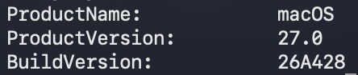
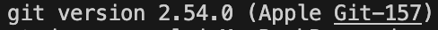
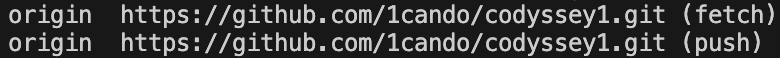

# codyssey1
# 코디세이 미션 수행 기술문서

## 1. 프로젝트 개요

### 미션 목표
본 프로젝트는 터미널 환경에서 기본적인 시스템 명령어와 권한을 이해하고, Docker를 활용한 컨테이너 환경을 구성하며, Git과 GitHub를 이용해 작업 내용을 관리하고 공유하는 것을 목표로 한다.

### 주요 수행 내용
- 터미널을 이용한 파일 및 디렉터리 관리
- 파일 권한 확인 및 변경
- Docker 이미지 및 컨테이너 관리
- Dockerfile 작성 및 이미지 빌드
- 포트 및 볼륨 설정과 검증
- Git을 이용한 버전 관리
- GitHub 저장소 생성 및 작업 결과 업로드

## 2. 실행 환경

| 항목 | 환경 |
|---|---|
| 운영체제(OS) | macOS [27.0] |
| 쉘(Shell) | /bin/zsh |
| 터미널 | macOS Terminal, VS Code 통합 터미널 |
| Docker | [29.9.2] |
| Git | git version 2.54.0 (Apple Git-157) |
| GitHub | https://github.com/1cando/codyssey1 |

### 환경 확인 명령어

```bash
sw_vers
echo $SHELL
docker --version
git --version
git remote -v
```

각 명령어의 실행 결과를 통해 운영체제, 쉘, Git 및 Docker 버전을 확인한다.

## 3. 수행 항목 체크리스트

### 3.1 터미널

| 확인 | 수행 항목 | 명령어 |
|---|---|---|
| [x] | 현재 위치 확인 | `pwd` |
| [x] | 파일 및 디렉터리 생성 | `mkdir`, `touch` |
| [x] | 파일과 폴더 목록 확인 | `ls`, `ls -al` |
| [x] | 디렉터리 이동 | `cd` |
| [x] | 파일 내용 확인 | `cat` |

#### ① 현재 위치 확인

**사용 명령어:** `pwd`

```bash
% pwd
/Users/[사용자계정]/codyssey
```

현재 터미널이 위치한 디렉터리의 경로를 확인한다.

#### ② 파일 및 디렉터리 생성

**사용 명령어:** `mkdir`, `touch`

```bash
% mkdir codyssey1
% cd codyssey1
% touch README.md
```

- `mkdir`: 새로운 디렉터리를 생성한다.
- `touch`: 새로운 빈 파일을 생성한다.

#### ③ 파일과 폴더 목록 확인

**사용 명령어:** `ls`, `ls -al`

```bash
% ls
codyssey1

% ls -al
drwxr-xr-x  13 [사용자계정]  staff   416 Oct 30 00:01 .git
-rw-r--r--@  1 [사용자계정]  staff    10 Oct 29 23:56 .gitignore
-rw-r--r--@  1 [사용자계정]  staff  5260 Oct 30 17:23 README.md
```

- `ls`: 현재 디렉터리의 파일과 폴더 목록을 확인한다.
- `ls -al`, `ls -la`: 숨김 파일을 포함하여 파일 권한, 소유자, 크기, 수정 날짜 등의 상세 정보를 확인한다.
- `-a`: 숨김 파일까지 표시한다.
- `-l`: 상세 정보를 표시한다.

#### ④ 디렉터리 이동

**사용 명령어:** `cd`

```bash
% cd codyssey
% cd codyssey1
% cd ..
% cd ~
```

- `cd codyssey`: codyssey 디렉터리로 이동한다.
- `cd ..`: 현재 디렉터리의 상위 디렉터리로 이동한다.
- `cd ~`: 사용자 홈 디렉터리로 이동한다.

#### ⑤ 파일 내용 확인

**사용 명령어:** `cat`

```bash
% cat README.md
# codyssey1
# 코디세이 미션 수행 기술문서

## 1. 프로젝트 개요

### 미션 목표
본 프로젝트는 ...
```

`cat` 명령어를 사용하여 README.md 파일에 작성된 내용을 터미널에서 확인한다.

#### ⑥ 절대 경로와 상대 경로

경로(Path)는 파일이나 디렉터리가 저장된 위치를 나타낸다.

**절대 경로(Absolute Path)**

- 루트 디렉터리(`/`)부터 시작하여 파일이나 폴더까지의 전체 경로를 나타낸다.
- 현재 터미널의 위치와 관계없이 동일한 경로를 사용할 수 있다.
- 예시: `/Users/[사용자계정]/codyssey/codyssey1/README.md`

**상대 경로(Relative Path)**

- 현재 작업 중인 디렉터리를 기준으로 파일이나 폴더의 위치를 나타낸다.
- 현재 위치에 따라 경로가 달라질 수 있다.
- 예시: `codyssey1/README.md`

**주요 경로 기호**

| 기호 | 의미 |
|---|---|
| `/` | 루트 디렉터리 |
| `~` | 사용자 홈 디렉터리 |
| `.` | 현재 디렉터리 |
| `..` | 상위 디렉터리 |

**실습 명령어**

```bash
# 상대 경로로 이동
cd ~/codyssey
cd codyssey1

# 상위 디렉터리로 이동
cd ..

# 절대 경로로 이동
cd ~/codyssey/codyssey1
cd /Users/[사용자계정]/codyssey/codyssey1
```

절대 경로는 전체 위치를 지정하는 방식이고, 상대 경로는 현재 위치를 기준으로 이동하는 방식이다.


### 3.2 파일 권한

파일 권한은 파일이나 디렉터리에 대해 사용자가 어떤 작업을 할 수 있는지 정하는 규칙이다.
리눅스와 macOS에서는 기본적으로 권한을 세 가지로 구분한다.

#### 3.2.1 파일 권한 표기 규칙 및 의미
리눅스의 파일 권한은 사용자가 파일이나 디렉터리에 대해 수행할 수 있는 작업을 제한하는 기능이다.

| 기호 | 숫자 | 영문 | 의미 | 설명 |
|---|---|---|---|---|
| r | 4 | Read | 읽기 | 파일 내용을 읽을 수 있음 |
| w | 2 | Write | 쓰기 | 파일 내용을 수정할 수 있음 |
| x | 1 | Execute | 실행 | 파일을 실행할 수 있음 |
| - | 0 | None | 권한 없음 | 해당 작업을 할 수 없음 |

각 숫자를 더하여 권한을 표현한다.

7 = 4 + 2 + 1 = rwx
6 = 4 + 2 = rw-
5 = 4 + 1 = r-x
4 = 4 = r--

- 755 권한: 소유자는 읽기, 쓰기, 실행이 가능하고 그룹과 그 외 사용자는 읽기와 실행이 가능하다. (rwxr-xr-x)
- 644 권한: 소유자는 읽기와 쓰기가 가능하고 그룹과 그 외 사용자는 읽기만 가능하다. (rw-r--r--)


#### 3.2.2 파일 권한 그룹
파일 권한은 세 그룹으로 구분한다.

| 기호 | 영문 | 대상 | 설명 |
|---|---|---|---|
| u | User | 파일 소유자 | 모든 권한 가능 | 
| g | Group | 파일이 속한 그룹 | 읽기와 실행 가능 |
| o | Others | 그 외 모든 사용자 | 읽기만 가능 |

#### 3.2.3 맨 앞 문자 종류
| 기호 | 종류 | 의미 |
|---|---|---|
| - | 일반 파일 | 텍스트, 이미지, 문서 등 |
| d | 디렉터리 | 폴더 |
| l | 심볼릭 링크 | 다른 파일이나 폴더를 가리키는 연결 |
| c | 문자 장치 파일 | 키보드, 터미널 등 문자 단위 장치 |
| b | 블록 장치 파일 | 디스크 등 블록 단위 장치 |
| p | 파이프 | 프로세스 간 데이터 전달 |
| s | 소켓 | 프로세스 간 통신 |

#### 3.2.4 파일 권한 명령어

| 확인 | 수행 항목 | 명령어 |
|---|---|---|
| [x] | 파일 권한 확인 | `ls -l` |
| [x] | 권한 변경 | `chmod` |

##### ① 파일 권한 확인

**사용 명령어:** `ls -l`

```bash
% ls -l permission-test.txt 
-rw-r--r--@ 1 [사용자계정]  staff  0 Oct 30 18:09 permission-test.txt
```

파일의 권한을 확인한다.

##### ② 권한 변경

**사용 명령어:** `chmod`

```bash
% chmod 600 permission-test.txt 
% ls -l
-rw-------@ 1 [사용자계정]  staff     0 Oct 30 18:09 permission-test.txt

% chmod 644 permission-test.txt
% ls -l
-rw-r--r--@ 1 [사용자계정]  staff     0 Oct 30 18:09 permission-test.txt

% chmod 755 permission-test.txt
% ls -l
-rwxr-xr-x@ 1 [사용자계정]  staff     0 Oct 30 18:09 permission-test.txt
```

파일의 권한을 변경한다.


### 3.3 Docker
- [ ] Docker 설치 및 실행 상태 확인
- [ ] 이미지 조회 및 관리
- [ ] 컨테이너 생성 및 실행
- [ ] 컨테이너 상태 확인 및 종료

사용 명령어: `docker --version`, `docker images`, `docker ps -a`

### 3.4 Dockerfile
- [ ] Dockerfile 작성
- [ ] 이미지 빌드
- [ ] 빌드 결과 확인

사용 명령어: `docker build`, `docker images`

### 3.5 포트 및 볼륨
- [ ] 컨테이너 포트 매핑 설정
- [ ] 포트 매핑 결과 확인
- [ ] 볼륨 또는 디렉터리 마운트 설정
- [ ] 데이터 유지 여부 확인

사용 명령어: `docker run`, `docker port`, `docker inspect`

### 3.6 Git 및 GitHub
- [ ] Git 저장소 초기화 또는 기존 저장소 확인
- [ ] 변경 파일 확인
- [ ] 변경 사항 커밋
- [ ] 원격 저장소 연결 확인
- [ ] GitHub에 푸시
- [ ] 원격 저장소에서 결과 확인

사용 명령어: `git status`, `git add`, `git commit`, `git remote -v`, `git push`

## 4. 검증 방법 및 결과

| 검증 항목 | 실행 명령어 | 확인 내용 | 결과 |
|---|---|---|---|
| 운영체제 | `sw_vers` | macOS 27.0 |  |
| Git | `git --version` | Git 버전 |  |
| 파일 권한 | `ls -l` | 파일 권한 정보 | [결과 링크 또는 기록 위치] |
| Docker | `docker ps -a` | 컨테이너 상태 | [결과 링크 또는 기록 위치] |
| 이미지 빌드 | `docker images` | 생성된 이미지 | [결과 링크 또는 기록 위치] |
| 포트 | `docker port [컨테이너명]` | 포트 매핑 정보 | [결과 링크 또는 기록 위치] |
| GitHub | `git remote -v` | 원격 저장소 주소 |  |

## 5. 트러블슈팅

### 5.1 문제 1: [실제로 발생한 문제]

**문제 상황**

[오류 메시지 또는 예상과 다르게 동작한 상황을 작성한다.]

**원인 가설**

[권한 문제, 설정 오류, 경로 문제 등 가능한 원인을 작성한다.]

**확인 과정**

```bash
[문제 원인을 확인하기 위해 실제로 실행한 명령어]
```

[명령어 실행 결과와 이를 통해 확인한 사실을 작성한다.]

**해결 방법**

[실제로 적용한 해결 방법과 변경 내용을 작성한다.]

**해결 결과**

[문제가 해결되었는지 확인한 명령어와 결과를 작성한다.]

### 5.2 문제 2: [실제로 발생한 문제]

**문제 상황**

[문제 및 오류 메시지]

**원인 가설**

[예상 원인]

**확인 과정**

```bash
[실제로 실행한 명령어]
```

[확인 결과]

**해결 방법**

[실제로 적용한 해결 방법 또는 대안]

**해결 결과**

[재검증 결과]

## 6. 결과물 위치

- GitHub 저장소: https://github.com/1cando/codyssey1
- 기술문서: https://github.com/1cando/codyssey1/README.md
- Dockerfile: [파일 링크]
- 실행 결과 및 스크린샷: [결과 파일 또는 디렉터리 링크]
- 기타 산출물: [해당 파일 링크]

## 7. 수행 결과 요약

본 미션에서는 [실제로 완료한 작업]을 수행하였다. 각 작업은 [사용한 검증 명령어 또는 방법]을 통해 확인하였다.

수행 과정에서 발생한 [실제 문제]는 [해결 방법]을 적용하여 해결하였으며, 최종 결과물은 GitHub 저장소에서 확인할 수 있다.
